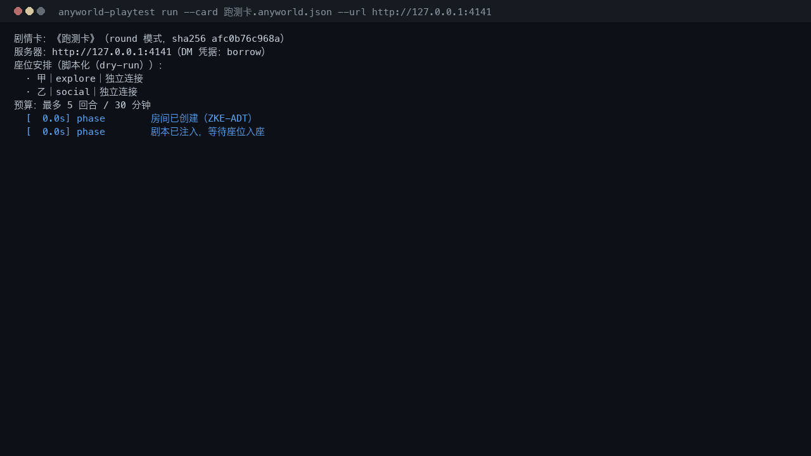
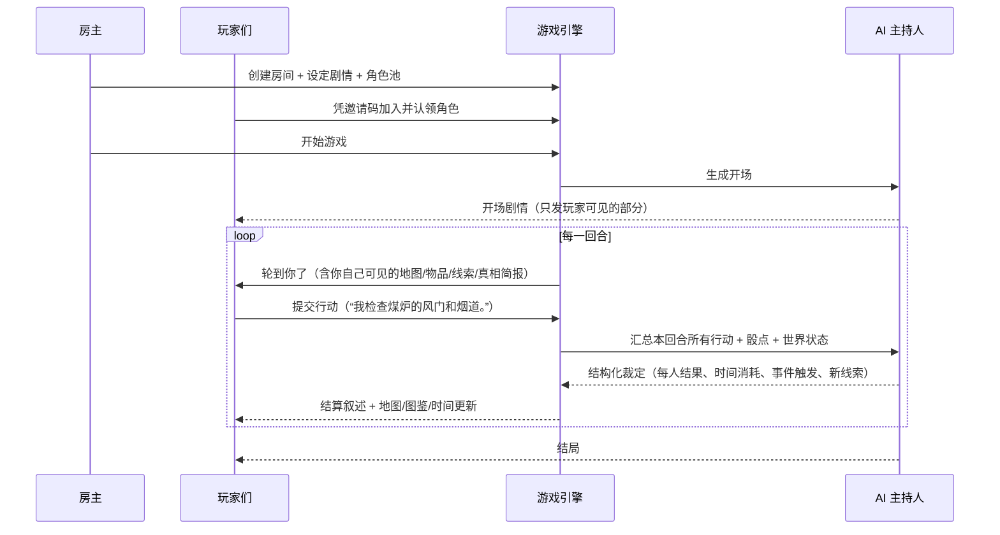
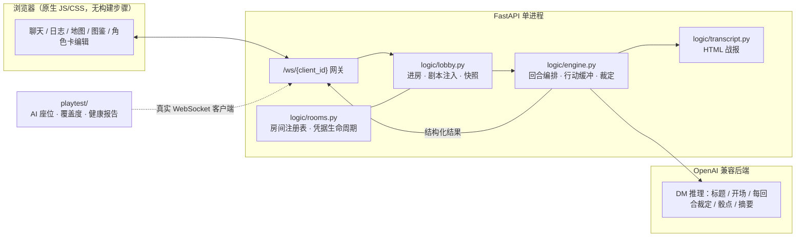

# MultiTavern · 多人酒馆

> **把 SillyTavern 的角色卡和预设，变成一场可以和朋友一起玩的多人跑团。**
> AI 当主持人（DM），每个人认领一个角色、同时行动、互相试探、彼此说谎，剧情实时推进——它更像一场真的桌面团，而不是轮流和 AI 聊天。

[](pyproject.toml)
[](LICENSE)
[](https://github.com/iamarxs/AnyWorld)
[](tests)
[](playtest/README.md)



<sub>上面是**真实终端输出**（`python -m playtest run`）：每个角色一个 AI 座位，接入真实服务器，把一张剧情卡从头跑到尾，最后给出覆盖度与健康检查。</sub>

---

## 目录

- [这是什么](#这是什么)
- [为什么值得一玩](#为什么值得一玩)
- [5 分钟跑起来](#5-分钟跑起来)
- [一局是怎么进行的](#一局是怎么进行的)
- [剧情卡跑测器：让 AI 座位替你把卡跑一遍](#剧情卡跑测器让-ai-座位替你把卡跑一遍)
- [做你自己的剧情卡](#做你自己的剧情卡)
- [功能清单](#功能清单)
- [架构](#架构)
- [常见问题](#常见问题)
- [开发与测试](#开发与测试)
- [与 AnyWorld 的关系与许可](#与-anyworld-的关系与许可)

---

## 这是什么

MultiTavern 是一个**自托管的多人 AI 跑团服务器**：

- 房主在一台机器上启动服务（自带 HTTPS，局域网/公网都能连），创建房间并设定剧情；
- 朋友们用邀请码进来，**各自认领一个角色**，用自己的话写行动；
- AI 作为主持人统一裁定所有人的行动、推进时间与剧情，并把结果讲回来。

它把 SillyTavern 生态里最好用的两样东西——**角色卡**和**文本预设**——搬进了一个真正多人的游戏框架里：角色卡决定"谁在说话"，预设决定"故事怎么被讲述"，而**玩家之间的互动**才是这个游戏的核心。

| 单人 AI 角色扮演 | MultiTavern |
| --- | --- |
| 你和一个 AI 单独聊天 | 3~6 个真人同时在场，各有各的角色与目标 |
| 轮流发言，互不影响 | 同一回合同时行动，AI 统一裁定谁先谁后、谁撞上谁 |
| 剧情由你一个人推动 | 别人会撒谎、会拆穿你、会在你行动到一半时插手 |
| 卡住了只能自己想办法 | 打不下去时还能让 AI 座位替你跑一遍，看卡到底哪里有问题 |

---

## 为什么值得一玩

- 🎭 **真·多人同场，而不是多开窗口**：每个玩家一条 WebSocket 连接、一个被认领的角色；行动按顺序收集、**同时结算**，因果关系连贯。
- 🧠 **AI 主持人有完整的世界状态**：时间轴、地区与物品、事件、世界书、可能的真相与线索，都由 DM 统一掌管，玩家只能看到自己该看到的部分。
- ⏱️ **时间真的在走**：可开启内部时钟（`round` 模式按轮推进，`strict` 模式按**每个行动耗时的分钟数**逐刻推进），定时事件到点就触发。
- 🃏 **导入即用**：支持 SillyTavern 角色卡（含 PNG 内嵌数据）与文本预设，世界书支持 `depth` / `role` 注入，后端不支持扩展采样时自动降级。
- 🔐 **凭据不外泄**：房主可自带 API Key（服务端加密存盘，密钥环丢失时房间暂停等你重填，**绝不会偷偷改用服主的 key**），或借用服主额度（可限额）。
- 🧪 **剧情卡可被自动跑测**：`playtest` 用 AI 座位把卡真跑一遍，输出覆盖度报告与卡死/原地打转/事件过期清单——做卡的人终于有回归测试了。
- 📴 **离线可玩的部分也想到了**：掉线有宽限期、断线玩家由 AI 代管、房间持久化、服务器重启后自动恢复。

---

## 5 分钟跑起来

```bash
git clone https://github.com/WONJU080/MultiTavern.git
cd MultiTavern
python -m venv venv && source venv/bin/activate     # Windows: venv\Scripts\activate
pip install -e .
```

编辑 `config.yaml`，填一个 OpenAI 兼容接口（以 DeepSeek 为例）：

```yaml
llm:
  provider: "compatible"
  endpoint: "https://api.deepseek.com/v1"
  api_key: "你的key"
  model_name: "deepseek-chat"
  structured_outputs: false
```

启动：

```bash
python app.py                 # 默认 https://0.0.0.0:4141（自签证书，浏览器点「继续前往」即可）
```

然后：

1. 房主打开页面 → **创建房间** → 设定剧情 / 角色池 / 世界书 / 时间系统（也可以直接**导入配置** JSON）；
2. 把邀请码发给朋友 → 他们**加入房间**并认领角色（也可以旁观）；
3. 房主点**开始游戏**，AI 生成开场；之后每人写自己角色的行动，DM 统一裁定并推进。

> 只想先看看它长什么样？`python -m playtest serve` 会打开**跑测台**（本地网页），不需要任何 key 就能先跑一遍干跑（`dry_run`），把整套流程和报告看明白。

部署、网络、证书、配置项与诊断的完整说明见 [`INSTALL.md`](INSTALL.md)。

---

## 一局是怎么进行的



要点：

- **行动是"尝试"，结果由 DM 决定**——玩家写"我试图推开门"，而不是"我推开门，发现里面有一具尸体"。
- **同时行动**：一回合里所有人的行动一起交给 DM，因此"我按住你的手腕不让你开门"是有意义的。
- **私密信息隔离**：房主写的主持私密指引只进 DM 的上下文，永远不下发到客户端；隐藏骰点同理。

---

## 剧情卡跑测器：让 AI 座位替你把卡跑一遍

这是本仓库相对上游最实用的新增：**用 AI 玩家自动把一张剧情卡玩完**，检查它到底能不能玩。

```bash
python -m playtest validate --cards examples                    # ① 离线体检：不联网、不花 token
python -m playtest check   --config playtest/configs/example.yaml   # ② 跑测前自检：服务器 / 凭据 / 座位端点
python -m playtest run     --config playtest/configs/example.yaml   # ③ 真跑：每个角色一个 AI 座位
python -m playtest serve                                        # ④ 网页跑测台（127.0.0.1:8787）
```

它会：

- 以**房主**身份建房、注入剧本、开游戏，再为**每个角色**开一条独立 WebSocket 连接与**独立 API 配置**（不同座位可以用不同模型）；
- 每个座位只拿到**这个玩家该看到的信息**（地图、图鉴、可能的真相、别人本回合已声明的行动），据此写行动；
- 处理真实对局里的一切麻烦：行动被裁判驳回要带理由重试、兜底行动有阶梯、同一回合提交次数有硬上限（**杜绝驳回死循环**）、DM 结算失败时以房主身份自动 `retry_round`、凭据被拒立刻整局停止；
- 结束后在 `playtest-runs/<时间戳>-<卡名>/` 写出 `run.json` + `report.md`：

  | 报告内容 | 说明 |
  | --- | --- |
  | 逐回合行动与结算 | 谁做了什么、DM 判了什么，一目了然 |
  | 覆盖度 | 地区 / 物品（含"已调查"）/ 事件 / 真相（含"已作答"）/ 时间推进 |
  | 座位统计 | 每个角色的调用次数、失败、重试、兜底、token 与耗时 |
  | 健康检查 | 卡死、原地打转、事件过期、线索不可达、真相永不揭晓等 |
  | 结论与退出码 | `0` 正常 / `2` 运行失败 / `3` 未达结局，可直接接进 CI |

- 勾上**调试落盘**后，每个座位收到的**完整提示词**与模型**原始回复**都会写进本次报告目录，便于定位"这 AI 怎么不像玩家"。

设计边界（有意为之）：跑测器**只报告**疑似引擎缺陷，不改引擎行为；座位提示词里**不含**引导、后台世界书与队伍闲聊；离线测试套件注入假 DM 与脚本化座位，**不消耗任何 token**。细节见 [`playtest/README.md`](playtest/README.md)。

---

## 做你自己的剧情卡

不用手写 JSON，把说明书交给 AI 助手代劳：

| 文件 | 用途 |
| --- | --- |
| [`examples/剧情卡制作指南.md`](examples/剧情卡制作指南.md) | **完整说明书**：逐字段讲清剧情卡能做什么、每个字段在游戏里触发什么行为，附角色卡、地区/物品世界系统、严格时间轴、插件、硬性限制速查表与一份完整可导入的示例 |
| [`examples/剧情卡生成提示词.md`](examples/剧情卡生成提示词.md) | 可直接复制粘贴的转换提示词模板（素材完整版 / 口述概要版） |
| [`examples/plot-to-config-prompt.md`](examples/plot-to-config-prompt.md) | 精简转换指令：**只转剧情与预设、不产出角色卡**，适合已有角色池的房间 |

流程：把说明书 + 你的素材（SillyTavern 剧情卡 / 世界书 / 预设 / 一段口述概要）一起发给 AI → 让它输出一个「多合一导入文件」→ 存成 `.json`，建房时点**导入配置**（导入是合并，不会清空已填内容）。

写完别忘了 `python -m playtest run` 让它自己跑一遍——**能跑完的卡才是能玩的卡**。

---

## 功能清单

| 分类 | 能力 |
| --- | --- |
| 房间 | 邀请码加入、旁观、中途加入（下一轮生效）、投票跳过挂机玩家、房间持久化与重启恢复、房主关房 |
| 角色 | 房主定义角色池（名字 / 描述 / 性格 / 文风 / 台词示例），玩家认领，**未被认领的角色由 AI 托管**，玩家可实时编辑自己的角色卡 |
| 主持 | 剧情设定 + **仅房主可见的主持私密指引**、开场生成、每回合结构化裁定、结局、token 用量广播 |
| 世界 | 世界书（关键词触发，支持 `depth` / `role`）、地区与移动、物品与调查、事件与定时触发、可能的真相与线索判定 |
| 时间 | `round` 模式（按轮）与 `strict` 模式（按每个行动的分钟数逐刻推进）、起始时间、耗时参考表、定时事件 |
| 提示词 | system / scenario / output 各位置的提示块、temperature / top_p 采样、SillyTavern 预设导入 |
| 接入 | OpenAI 兼容接口（llama.cpp / Ollama / DeepSeek / OpenAI…）、`/props` 自动探测上下文长度、tokenizer 与保守估算兜底 |
| 凭据 | 房主自带 key（Fernet 加密存盘）或借用服主 key（可限额）、endpoint 白名单、密钥环丢失时暂停而非静默换 key |
| 运维 | `/admin/rooms` 面板（仅此面板受 admin 密码保护）、房间上限、空闲/废弃房间回收、可选原始响应落盘 `.debug/llm/` |
| 测试 | 约 570 项离线测试（假 DM + 脚本化座位）、剧情卡跑测器、离线体检与健康报告 |

---

## 架构



- **单进程、共享一个事件循环**，房间之间靠 `RoomRegistry` 隔离；每个房间一个引擎实例，所有状态变更都在锁内完成、网络 I/O 在锁外。
- **推理是独立任务**，不属于任何 socket 接收循环，用 generation ID 防止过期结果回写；本轮推理失败会**保留行动与骰点**并暂停，等房主重试。
- **上下文管理**：稳定前缀 + 固定剧本/指引 + 独立持久记忆 + 最近历史 + 当前输入；压缩按预算进行且可回滚，失败/膨胀的摘要一律保留原上下文，**没有 FIFO 遗忘兜底**。

---

## 常见问题

**Q：浏览器提示"你的连接不是私密连接"？**
自签证书的正常现象，选择「继续前往」即可；想消除提示就用正式证书或本地反代。

**Q：我该把 API Key 放哪？**
服务器自己的 key 放 `config.yaml` 的 `llm.api_key`（借用模式用）。房主也可以在**创建房间时填自己的 key**，它会加密存在服务端，只在属于这个房间的调用里使用。

**Q：座位报 401 / `Incorrect API key`？**
说明 endpoint 和 Key 不是同一家（例如 endpoint 留空会打到 OpenAI 官方，而 Key 是别家的）。跑测器会在**第一次 401 时立刻停止整局**并写明是哪个座位，不会重试到烧额度。

**Q：指向本机 / 局域网的模型（llama.cpp、Ollama）连不上？**
本机与内网地址默认**直连、不走系统代理**（代理无法回连 loopback）；公网地址跟随系统代理。单个座位可用 `proxy: true/false` 覆盖。

**Q：座位报"返回了空行动"？**
多半是推理型模型把输出额度用在了思考上（`finish_reason=length`）。跑测器会自动把 `max_output_tokens` 翻倍重试一次，并把诊断（`finish_reason`、推理字数、输出 token 数）写进日志；仍为空就换非推理模型，或调大 `seats.default.max_output_tokens`。

**Q：AI 写的行动很短，是不是坏了？**
不是。提示词要求座位像真人一样**只写一句输入框里的话**（默认上限 80 字，尽量 40 字以内），超长回复会被整句截断——这是为了让多人同场时的节奏接近真人。

**Q：能和朋友在公网玩吗？**
可以，注意开放端口、用正式证书或反代 HTTPS；也可以直接放在局域网/VPN 里玩。

**Q：我做的剧情卡能分享吗？**
卡是纯 JSON，随便分享；但**不要把别人的角色卡和世界书当成自己的作品**，也注意卡里可能包含 R18 或版权内容——本仓库不附带任何实际剧情卡。

---

## 开发与测试

```bash
black --check app.py api core logic tests playtest
flake8 app.py api core logic tests playtest
PYTHONDONTWRITEBYTECODE=1 python -B -m pytest -p no:cacheprovider     # 约 570 项，全部离线
```

测试约定：**不在 pytest 里起真实服务器、不跑真实推理**——全部用假 DM（`tests/test_engine.py::FakeResolver`）、进程内 ASGI 会话与脚本化座位；测试在临时目录里跑并清理产物。想验证真实后端时用 `playtest`。

贡献前请读一遍 `logic/` 各模块顶部的文档字符串：回合编排、上下文预算与私密信息隔离都有明确契约（例如"网络 I/O 不进状态锁"、"私密指引与隐藏骰点绝不下发客户端"）。

---

## 与 AnyWorld 的关系与许可

本项目基于 [**AnyWorld**](https://github.com/iamarxs/AnyWorld)（MIT License，Copyright © 2026 iamarxs）开发，在其之上做了多人化改造、汉化、SillyTavern 兼容、世界系统与剧情卡跑测器等扩展。原项目的许可与版权声明保留在 [`LICENSE`](LICENSE) 中。

本项目同样以 **MIT License** 发布。欢迎 fork、提 PR、开 issue；如果它让你和朋友度过了一个愉快的晚上，给个 ⭐ 就是最好的回报。
